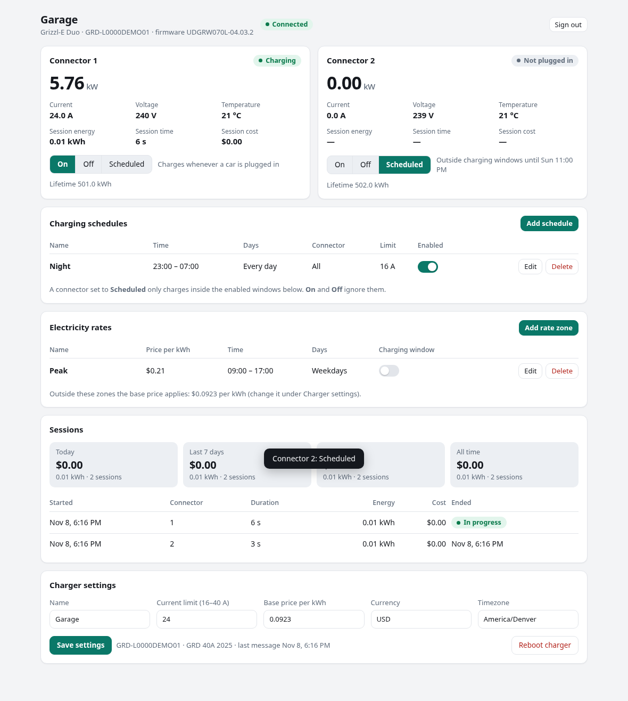

# Grizzl-E local server

A drop-in replacement for the Grizzl-E Connect cloud that runs on your own network.
Nothing leaves your LAN: the charger talks to this container, and the
[Home Assistant integration](../ha-grizzl-e-connect) talks to this container.

```
 Grizzl-E Duo ──OCPP 1.6-J (WebSocket)──▶ grizzle-local ◀──REST (same API as the cloud)── Home Assistant
                                           │
                                           └─ /data: state.json + history.sqlite
```

- **OCPP 1.6-J central system** for the charger: BootNotification, StatusNotification,
  Authorize, Start/StopTransaction, MeterValues, Heartbeat, DataTransfer.
- **Charging modes the way the cloud does them.** A Grizzl-E Connect never starts a
  session on its own: it reports *Preparing* and waits for `RemoteStartTransaction`.
  *Active* answers immediately, *Inactive* never does (and stops a running session),
  *Schedule* only inside enabled windows.
- **Schedules and rate zones** in the app's `pricesByZone` format, evaluated in the
  station's timezone, with per-window current limits. Session cost is computed from
  the matching rate zone or the base price.
- **Current limit** via `SetChargingProfile` at stack level 0 (the only level the
  charger honours), re-applied after every reboot.
- **Tolerant framing.** Grizzl-E firmware replies to `GetConfiguration` with invalid
  JSON (`"configurationKey":]`). The server repairs or drops bad frames instead of
  letting the socket die.
- **Built-in web page** at `http://<server>:9000/` for live status, charging modes,
  schedules, electricity rates, statutory holidays, charger settings and session history
  with cost.
- **Statutory holidays** for 250 countries and their states or provinces, computed
  offline. Each schedule and rate zone chooses how it treats a holiday, and a flat holiday
  price can replace the rate zones for the day.
- **REST API shaped like `connect-api.unitedchargers.com`**, so the Home Assistant
  integration only needs a different server URL. Plus a few `/local/...` extras:
  raw OCPP calls, the frame log, meter history.
- Single process, single port, two dependencies (aiohttp, holidays), state survives restarts.

> Reverse engineered from the Grizzl-E Connect app and community OCPP work. Not
> affiliated with United Chargers. MIT licensed. Confirmed connecting and controlling a real Grizzl-E
> Duo; see **Status** below for what has and hasn't been exercised yet.

## 1. Run it (TrueNAS SCALE or any Docker host)

A multi-arch image (amd64, arm64) is published to GitHub Container Registry on every
push to `main`: `ghcr.io/lunarminus/grizzle-local:latest`.

**TrueNAS SCALE:** *Apps → Discover Apps → ⋮ → Install via YAML*. Paste
[`docker-compose.yml`](docker-compose.yml), change `GRIZZLE_API_PASSWORD` and `TZ`, and
point the two volumes at a dataset, e.g. `/mnt/tank/apps/grizzle-local/data` and
`/mnt/tank/apps/grizzle-local/certs`. For the DNS-override setup put a certificate in the
`certs` folder first (see section 2). Save, and the app pulls the image and starts.

> **Port 443 is taken by the TrueNAS web UI**, so the app fails to start with
> "address already in use" until you free it. Either move the UI: *System → General
> Settings → GUI → Settings*, set **Web Interface HTTPS Port** to e.g. 9443 (the UI is then
> at `https://<nas-ip>:9443`); or give the container its own address: add an IP alias to
> the NIC under *Network → Interfaces*, set the GUI's **Web Interface IPv4 Address** to the
> NAS's primary IP, bind the port as `"<alias-ip>:443:8443"` in the compose file, and point
> the DNS override at the alias IP.

**Any Docker host:**

```bash
git clone https://github.com/lunarminus/grizzle-local-server.git && cd grizzle-local-server
# edit docker-compose.yml: password, timezone
scripts/make-cert.sh ./certs
docker compose up -d
curl http://localhost:9000/health
```

To build from source instead of pulling, swap `image:` for `build: .` in the compose file
and run `docker compose up -d --build`.

Environment variables (all optional):

| Variable | Default | Meaning |
|---|---|---|
| `TZ` / `GRIZZLE_TIMEZONE` | `UTC` | Timezone schedules are evaluated in (new stations inherit it) |
| `GRIZZLE_PORT` | `9000` | WebSocket + REST port |
| `GRIZZLE_API_EMAIL`, `GRIZZLE_API_PASSWORD` | `admin@local`, `grizzle` | Login for the REST API (what Home Assistant uses). **Change the password.** |
| `GRIZZLE_OCPP_PASSWORD` | unset | If set, the charger's HTTP Basic password ("Auth key") must match; this is the strongest option. Without it, each station is pinned to the first Auth key it presents (see below) |
| `GRIZZLE_HEARTBEAT_INTERVAL` | `300` | Seconds, pushed to the charger at boot |
| `GRIZZLE_METER_INTERVAL` | `30` | Seconds between MeterValues while charging |
| `GRIZZLE_ID_TAG` | `uc_default_auth` | idTag used for RemoteStartTransaction |
| `GRIZZLE_MIN_CURRENT`, `GRIZZLE_MAX_CURRENT` | `6`, `40` | Bounds for unknown models (Duo is detected as 16–40 A, 2 connectors) |
| `GRIZZLE_TLS_PORT`, `GRIZZLE_TLS_CERT`, `GRIZZLE_TLS_KEY` | `8443`, `/certs/fullchain.pem`, `/certs/privkey.pem` | `wss://` listener; enabled automatically when both files exist |
| `LOG_LEVEL` | `info` | `debug` logs every OCPP frame |

## 2. Point the charger at it: DNS override

The charger does **not** use `connect-api.unitedchargers.com`; that is the phone app's
REST API. The charger is an OCPP client connecting to `wss://ocpp.unitedchargers.com/ocpp1.6`,
and the Connect/Duo firmware gives you no way to change that address (the app has no OCPP
settings screen and the web interface has no OCPP page unless the vendor unlocks it). So we
answer to that name instead: make `ocpp.unitedchargers.com` resolve to the server on your
LAN. The charger opens `wss://` to port 443 on the server, which needs a certificate for
that name. `scripts/make-cert.sh` writes a self-signed one and the server turns TLS on
automatically when the files exist (the compose file maps `443:8443` and mounts `./certs`).
A Duo on firmware `UDGRW070L-04.03.2` does not verify the certificate, so this works.

```bash
scripts/make-cert.sh ./certs
docker compose up -d
docker compose logs -f        # look for "and wss:// on 8443"
```

**OPNsense / Unbound** (the typical setup):

1. *Services → Unbound DNS → Overrides → Host Overrides → +*: Host `ocpp`, Domain
   `unitedchargers.com`, Type `A`, IP = the server's LAN address. Save, Apply.
2. Check the charger actually uses OPNsense for DNS: *Services → DHCPv4 → Leases*,
   find the charger, and make sure the DHCP server hands out OPNsense as the DNS server
   (the default). If the firmware ignores DHCP DNS and uses 8.8.8.8 or similar, force it
   with a NAT port forward: *Firewall → NAT → Port Forward → +*, interface LAN,
   protocol TCP/UDP, source = the charger's IP (or any), destination = *invert* "LAN address",
   port 53, redirect target 127.0.0.1 port 53. Also block outbound TCP 853 (DNS over TLS).
3. Verify from any LAN machine: `dig ocpp.unitedchargers.com @<opnsense-ip>` returns the
   server IP. Then power-cycle the charger so it drops its cached address.
4. Watch `docker compose logs -f`:
   - `TLS: connection from <charger-ip>`, `handshake … OK`, then `GRD-… booted`: it works.
   - `TLS: <charger-ip> REJECTED OUR CERTIFICATE`: that firmware verifies certificates and
     this approach can't work on it. Open a United Chargers support ticket asking for OCPP
     configuration to be enabled on your serial.
   - `handshake … OK` but no `booted`: TLS is fine and the problem is at the OCPP level;
     set `LOG_LEVEL=debug`.
   - Nothing at all: the charger isn't resolving the name to us. Recheck step 2, or run
     `tcpdump -ni <lan> host <charger-ip> and port 53` on OPNsense.

Other DNS servers (Pi-hole, AdGuard Home, a router's local DNS) work the same way: add a
local A record for `ocpp.unitedchargers.com` pointing at the server.

Overriding `connect-api.unitedchargers.com` is not needed for normal operation: Home
Assistant is pointed at the server directly, and the phone app can't be made to work this
way anyway (it uses HTTPS with normal certificate checks). Block that host at the firewall
if you want the app silenced. Once the charger is on the local server the vendor app stops
seeing it.

**Optional — keep third-party OCPP "unlocked".** Newer Grizzl-E firmware gates custom OCPP
backends behind a check the charger makes to `connect-api.unitedchargers.com/commercial/
ext-ocpp-check/<serial>`. The check carries no server secret (the expected answer is just a
hash of the public serial), so this server can satisfy it: add a **second** DNS override so
`connect-api.unitedchargers.com` also resolves to the server (same TLS listener on 443; the
charger does not verify the certificate), and the built-in `GET /commercial/ext-ocpp-check/
{serial}` endpoint answers it. On by default; set `GRIZZLE_OCPP_UNLOCK=0` to disable. Leave
it off unless your firmware actually enforces the unlock — if local OCPP already works, you
don't need it.

**Who may connect as a charger.** A charger is identified by its serial (the last path segment, else
the HTTP Basic user), which must match `[A-Za-z0-9][A-Za-z0-9._:-]{0,63}`.

- With `GRIZZLE_OCPP_PASSWORD` set, the Basic password must equal it, and that is the only check.
- Without it, the first Auth key (Basic password) a station presents is pinned and saved at once.
  From then on a connection for that serial with a different key, or none, is refused
  (`rejected connection ... Auth key does not match` in the log). If you change the charger's Auth key
  or replace the charger, call `DELETE /local/stations/{serial}/auth-key`; the charger is
  disconnected and its reconnect pins the new key. Whoever connects first under a serial the server
  has never seen gets to pin it, so connect your charger before exposing the server to other devices.
- A station whose charger connects without a key is never pinned automatically, so nobody can lock
  it out by presenting a key while it's offline. Such a connection can't be authenticated: it may add a
  new station, and may replace a station's existing connection only if that one stops answering
  (a 5 s probe). Set `GRIZZLE_OCPP_PASSWORD` if your charger sends no key.
- WebSocket handshakes carrying an `Origin` header (that is, from a browser) are refused; the
  charger's firmware doesn't send one.

You can test the whole chain without the real charger: `tools/fake_charger.py` accepts
`wss://…` URLs with `--insecure`. The plain `ws://` listener on port 9000 also accepts
chargers, for firmware that does let you set a server URL.

## 3. Open the web page

Browse to `http://<server-ip>:9000/` and sign in with `GRIZZLE_API_EMAIL` /
`GRIZZLE_API_PASSWORD`.



- **Connectors**: live power, current, voltage, temperature and the running session, with
  an On / Off / Scheduled switch per connector.
- **Charging schedules**: windows in which a connector set to *Scheduled* may charge, with
  days, an optional connector and an optional current limit for that window. Days are
  calendar days: "weekdays 20:00-06:00" covers 00:00-06:00 and 20:00-24:00 of each weekday,
  so it includes Monday's small hours and stops at midnight on Friday.
- **Electricity rates**: a base price plus time-of-use zones, typed in cents per kWh.
  Session cost is computed from whichever price applies as energy is delivered.
- **Statutory holidays**: pick a country and region to load its holidays, untick the ones
  your utility doesn't count, add your own dates, and optionally set a flat holiday price.
  Every schedule and rate zone then has an *On statutory holidays* choice: treat it like
  any other day (the default), not on holidays, on its days and every holiday too, or only
  on holidays. For example "Peak, weekdays, not on holidays" plus a holiday price gives the
  usual utility rule that holidays are off-peak all day.
- **Sessions**: every session with duration, energy and cost, and totals for today, the
  last 7 and 30 days, and all time. **Recalculate costs** reprices every recorded session
  with the current base price, rate zones and holidays, using the stored meter readings, so
  sessions recorded before you set (or after you changed) your rates come out right.
- **Charger settings**: name, current limit (bounded by the DIP switch), base price,
  currency and the timezone schedules are evaluated in.

The page is a single self-contained file (no external scripts or fonts), follows the
browser's light or dark theme and works on a phone. To show it inside Home Assistant, add
a *Webpage* card pointing at the same address; that only works when Home Assistant itself
is opened over plain `http://`, because browsers won't embed an `http://` page in an
`https://` one.

## 4. Connect Home Assistant

In the integration's *Add → Grizzl-E Connect account* step, set **Server URL** to
`http://<nas-ip>:9000` and log in with `GRIZZLE_API_EMAIL` / `GRIZZLE_API_PASSWORD`.
Everything else (modes, current limit, schedules, rates, reboot, the card) works
unchanged. Station ids are the charger serial, which is also the device identity, so
a charger that was previously added through the cloud keeps the same entities when you
switch.

## REST API

Same paths and bodies as the cloud, Bearer-token auth:

| Method & path | Body |
|---|---|
| `POST /client/auth/login` | `{"emailOrPhone", "password"}` → `{token, refreshToken, user}` |
| `POST /client/auth/refresh-token` | `{"refreshToken"}` |
| `GET /client/stations` | → `{"stations": [...], "groups": []}` |
| `GET /client/stations/{serial}` | |
| `POST /client/stations/{serial}/mode` | `{"mode": "Active"\|"Inactive"\|"Schedule", "connectorId": 0..n}` (0 = all) |
| `PUT /client/stations/{serial}/currentLimit` | `{"value": amps}` |
| `POST /client/stations/{serial}/scheduleUpdate` | `{"price": {...}}` charging window; returns the station plus `_id` of the window |
| `POST /client/stations/{serial}/pricesByZoneUpdate` | `{"price": {...}}` rate zone |
| `POST /client/stations/{serial}/scheduleEnable` | `{"_id", "scheduleEnabled"}` |
| `DELETE /client/stations/{serial}/scheduleDelete/{id}`, `.../pricesByZoneDelete/{id}` | |
| `PUT /client/stations/{serial}/rate` | `{"priceKW": 0.12}` |
| `POST /client/stations/{serial}/reboot` | → OCPP `Reset` result |
| `GET /client/stations/{serial}/events` | completed sessions |

Local extras (same auth):

| Method & path | Purpose |
|---|---|
| `POST /local/stations/{serial}/ocpp` | `{"action": "GetConfiguration", "payload": {}}`: send any OCPP call, get the raw reply |
| `GET /local/stations/{serial}/sessions?limit=100` | session history incl. sessions in progress, plus totals (what the web page shows) |
| `POST /local/stations/{serial}/sessions/recalculate` | reprice all sessions with the current rates; returns `{sessions, cost_before, cost_after}` |
| `GET` / `PUT /local/stations/{serial}/holidays` | holiday settings: `{"enabled", "country", "subdivision", "observed", "priceKW", "excludedNames", "extraDates"}`; returns them with the next 12 months of holidays |
| `POST /local/stations/{serial}/holidays/preview` | the same response for settings you haven't saved |
| `GET /local/holidays/countries` | supported countries and subdivisions |
| `GET /local/stations/{serial}/log` | the last 200 OCPP frames in either direction |
| `GET /local/stations/{serial}/samples?since=ISO&connector=1` | meter history (kept 90 days) |
| `PUT /local/stations/{serial}/settings` | `{"displayName", "timezone", "connectorCount", "maxCurrent", "minCurrent", "dipSwitchCurrentLimit"}` |
| `DELETE /local/stations/{serial}` | forget a station (only while it's disconnected) |
| `DELETE /local/stations/{serial}/auth-key` | forget the Auth key the station is pinned to and drop its connection; the charger's reconnect pins its key again |
| `GET /health` | no auth |

Prices in the API are per kWh in the main currency unit (`0.0923`), as in the cloud; only the web
page shows cents. Schedules and rate zones (the `price` object) accept one field the cloud doesn't have:
`"holidays": "same" | "skip" | "also" | "only"`. Stations also report `holidaysSettings`,
the upcoming `holidays` and `holidayToday`.

## Development

```bash
python -m venv .venv && . .venv/bin/activate
pip install -r requirements-dev.txt
pytest                                      # schedules, TLS, end-to-end with the fake charger
GRIZZLE_DATA_DIR=./data GRIZZLE_PORT=9000 python -m grizzle_local
python tools/fake_charger.py ws://localhost:9000/ocpp1.6/GRD-FAKE0001 --plug-in 5
```

```
grizzle_local/
├── ocpp.py        # OCPP-J framing, call/result matching, malformed-frame repair
├── controller.py  # station state, message handlers, mode/schedule enforcement, commands
├── schedules.py   # pricesByZone window evaluation, next change, price lookup
├── holiday_calendar.py  # statutory holidays per country/region (the `holidays` package)
├── api.py         # REST facade + station JSON in the cloud's shape
├── store.py       # state.json + history.sqlite
├── config.py      # env vars
├── tls.py         # wss:// front door with handshake logging
├── web/index.html # the built-in web page (inline CSS and JS, no build step)
└── main.py        # aiohttp app: WebSocket upgrade on any path, REST
tools/fake_charger.py   # simulated Grizzl-E, also used by the tests
scripts/make-cert.sh    # self-signed certificate for ocpp.unitedchargers.com
```

## Status

Verified against a real Grizzl-E Duo 40A (`GRD 40A 2025`, firmware `UDGRW070L-04.03.2`)
on 2026-11-08, connected through the DNS override:

- The charger **does not verify the server certificate**: it completed a TLS 1.2
  handshake against the self-signed cert and connected, so the DNS override works.
- It connects to path `/ocpp1.6` with no station id in the URL and identifies itself with
  HTTP Basic auth (user = serial), which the server uses as the charge point id.
- BootNotification, StatusNotification (connectors 0, 1, 2), RemoteStartTransaction
  (Accepted), StartTransaction, MeterValues every 30 s and GetConfiguration (34 keys,
  valid JSON on this firmware) all behave.
- MeterValues carry Current.Import (A), Voltage (V), Energy.Active.Import.Register (Wh),
  Power.Active.Import (**kW**) and Temperature (Celsius). The energy register in
  MeterValues is **relative to the session start** (begins at 0) while
  `StartTransaction.meterStart` is the lifetime register in Wh; the server detects this and
  reports session energy and lifetime totals correctly.
- Useful configuration keys the charger exposes: `DipSwitchCurrentLimit` (read
  automatically into the station, so the HA slider gets the right maximum),
  `NumberOfConnectors`, `AuthTag` (`uc_default_auth`), `ChargeProfileMaxStackLevel` 4,
  `ChargingScheduleAllowedChargingRateUnit` Current, `AuthorizeRemoteTxRequests` false,
  `Autostart` false, `SupportedFeatureProfiles` Core, FirmwareManagement, SmartCharging,
  RemoteTrigger.

Still to confirm, in order:

1. An actual charging session (the test car was full, so the connector sat in
   *SuspendedEV*): power and current readings, session energy and cost climbing.
2. `SetChargingProfile` is accepted and the car's current actually changes
   (`PUT /client/stations/{serial}/currentLimit`).
3. *Inactive* mode: `RemoteStopTransaction` is accepted and the charger goes back to
   *Preparing* rather than *Finishing → Available*.
4. Schedule mode across a window boundary.

Open question: whether DataTransfer is ever used by this firmware (none seen so far; it
would be logged and kept in the station's `dataTransfers`).
